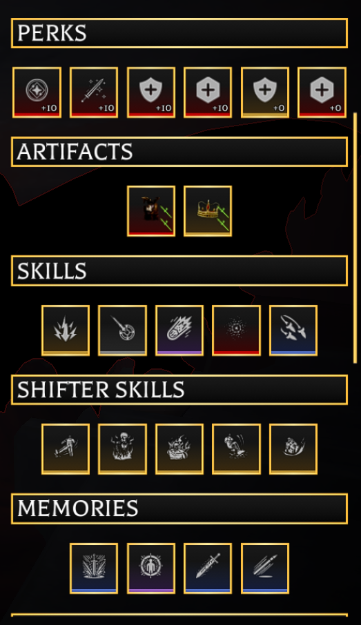

# Index
[OUTSKIRTS](https://github.com/smollers/smol-macros/releases/tag/outskirts) (NO BLOOD AWAKENED)
FIXED!!!!

## [OUTSKIRTS](https://github.com/smollers/smol-macros/releases/tag/outskirts)
### Features:
- You can start at the end screen or when u spawn in
> they both work and it will detect where u are

- Auto detects if the run is stuck and kills itself without wasting more time

- it uses image and pixel detection
> it is way more consistent and don't worry about being grabbed, it detects it

> *please report any issues or bugs in [here](https://github.com/smollers/smol-macros/issues)*

## Requirements:
- Fritz
- Scorched cloak TS dmg
- Crown or anything with TS dmg
- Resonance for col (You can tweak it to work without)
- 1920x1080p
- 100% Scaling
- game graphics: 4
- Full screen
- No Shiftlock

### Memories:
- Apotheosis (important)
- supernova (better consistency/winrate)

### Loadout & Tree
- **Tree:**
Right, Right, Right (before the syringe by two)

- Perks: 
**Founders/Avatar of Ymir, Kengo/Godforged, Adaptation, Soulfeed, Invincible (no injuries), FOI**
-----------------------

> Notes: Just try to get the highest TS damage and Awk bar gain as possible, the higher the more consistent it will be
> - It will make barely any/no mistakes at all since it goes by with image and pixel detection
> - If you get godforged or ymir, i believe the winrate will be very clsoe to 100%

### Video of it in action:
(soon)
(just start it when u spawn in or when u are in the end screen, it detects and both will work)
(i actually went crazy on ts if u find any probelm where u die TAKE A SCREENSHOT OF THE END SCREEN AND DM ME)
This took a whole make to make and a lot of retries and deaths....
